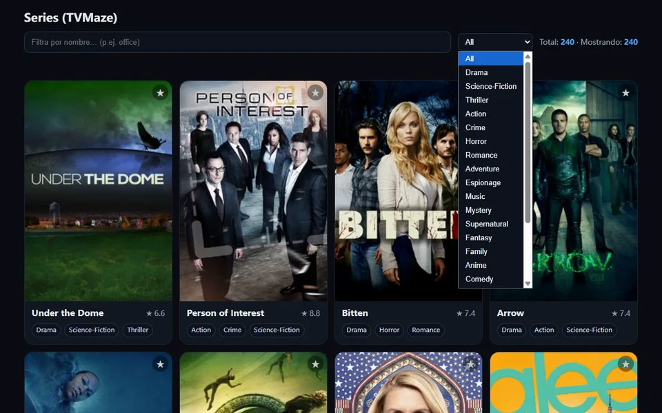

# Explorador de series con TVmaze

Aplicación en React para filtrar series por título y género, consultar sus fichas y guardar favoritos en el navegador.

<a href="media/demo.mp4"></a>

## Ejecutar en local

Necesitas Node.js 22.12 o posterior y conexión a internet.

```sh
npm ci
npm run dev
```

Datos de [TVmaze (CC BY-SA)](https://www.tvmaze.com/api#licensing).
